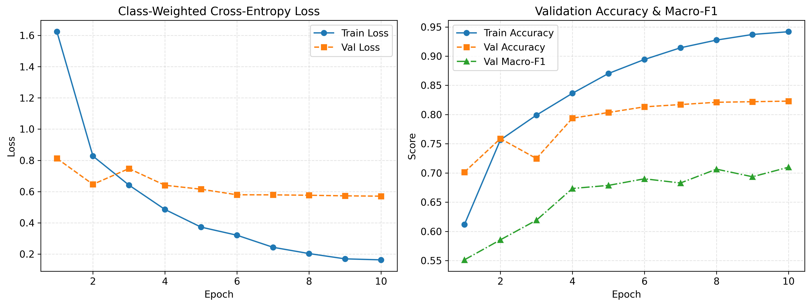
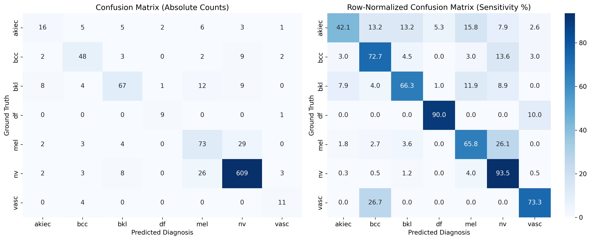
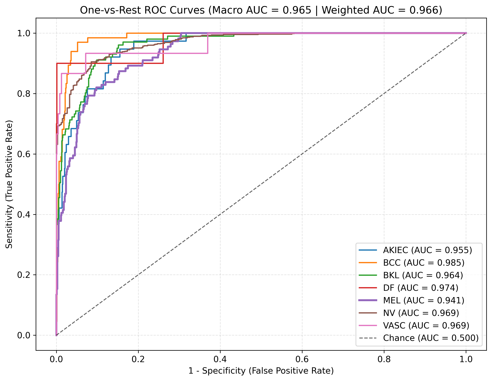
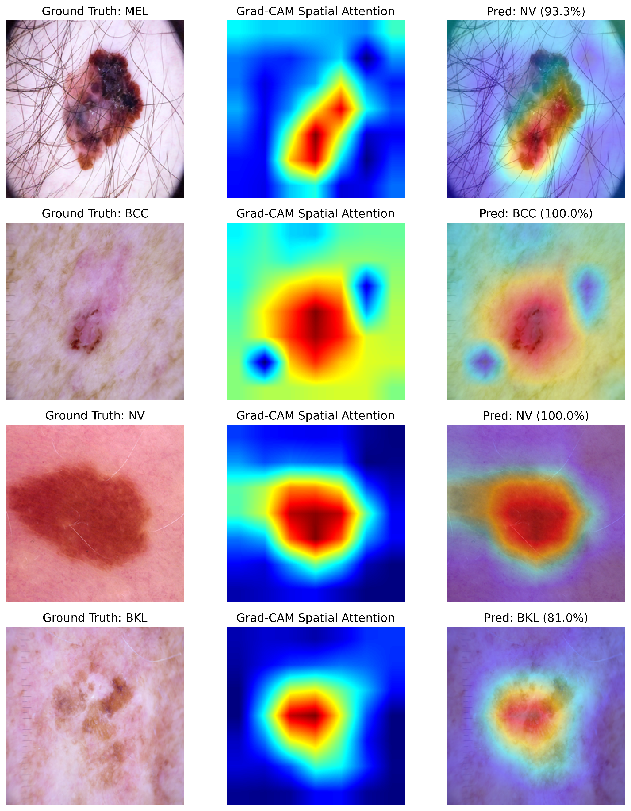

# Automated Dermatoscopic Skin Lesion Classification via Deep Convolutional Neural Networks: Addressing Severe Class Imbalance and Visual Explainability

## 1. Abstract & Clinical Motivation
Early detection of cutaneous melanoma (`mel`) and non-melanoma skin cancers (`bcc`, `akiec`) significantly improves 5-year patient survival rates. However, visual inspection of dermatoscopic images is subject to high inter-observer variability, and automated deep learning classifiers trained on benchmark datasets such as **HAM10000** face two critical biomedical engineering bottlenecks:
1. **Severe Class Imbalance:** Benign melanocytic nevi (`nv`, $n=6,705$) outnumber dermatofibromas (`df`, $n=115$) and vascular lesions (`vasc`, $n=142$) by nearly $60:1$, causing standard empirical risk minimization to overfit to the majority class while yielding low sensitivity on malignant lesions.
2. **Lack of Clinical Interpretability ("Black-Box" Predictions):** High test accuracy alone is insufficient for clinical decision support if a Convolutional Neural Network (CNN) relies on spurious imaging artifacts (e.g., ruler markings, air bubbles, or illumination vignetting) rather than lesion morphology.

This repository presents an end-to-end training, evaluation, and visual explainability framework built on a pretrained **EfficientNet-B0** architecture that mitigates class skew via **smoothed inverse-frequency class-weighted cross-entropy loss** and integrates **Gradient-weighted Class Activation Mapping (Grad-CAM)** to verify morphological feature attribution across all 7 diagnostic categories.

## 2. Dataset Preprocessing & Leakage-Free Splitting
Experiments are conducted on the **ISIC 2018 / HAM10000** dermatoscopic archive ($N=10,015$ images across 7 diagnostic classes):
* **Lesion-ID Stratified Group Splitting (`StratifiedGroupKFold`):** Because HAM10000 contains multiple sequential or magnified photographs of the same physical lesion (`lesion_id`), naive random splitting causes data leakage between training and test sets. We enforce strict lesion-grouped stratified splitting (**7,995 Train / 1,028 Validation / 992 Held-Out Test**), ensuring zero `lesion_id` overlap across splits.
* **Spatial & Photometric Augmentations:** Training images are resized to $224 \times 224$ pixels and augmented with random horizontal/vertical flips, random rotations ($\pm 25^\circ$), color jitter (brightness/contrast/saturation $\pm 0.15$), and ImageNet channel normalization ($\mu = [0.485, 0.456, 0.406]$, $\sigma = [0.229, 0.224, 0.225]$).

## 3. Model Architecture & Training Protocol
* **Backbone Network:** Pretrained `EfficientNet-B0` (`timm` implementation) utilizing inverted residual blocks and squeeze-and-excitation attention, coupled with dropout regularization ($p=0.3$) and a 7-class linear classification head.
* **Imbalance-Aware Objective Function:** To prevent minority-class collapse without over-penalizing majority precision, class weights $w_c$ are scaled by the square root of inverse training frequency:
$$w_c = \sqrt{\frac{N_{\text{train}}}{K \cdot N_{c, \text{train}}}}$$
* **Optimization:** Trained for 10 epochs with mixed-precision (FP16) using `AdamW` ($\text{lr} = 3 \times 10^{-4}$, weight decay $= 10^{-4}$) and cosine annealing learning rate scheduling, selecting the checkpoint maximizing validation Macro F1-score.

## 4. Quantitative Medical Evaluation
Standard top-1 accuracy masks diagnostic failure on rare classes. We report class-wise **Precision (Positive Predictive Value)**, **Sensitivity (Recall / True Positive Rate)**, **Specificity (True Negative Rate)**, **F1-Score**, and **One-vs-Rest (OvR) ROC-AUC** on the unseen lesion-stratified test set ($N_{\text{test}} = 992$):

| Diagnostic Category | Code | Test Support | Precision | Sensitivity (Recall) | Specificity | F1-Score | ROC-AUC (OvR) |
| :--- | :---: | :---: | :---: | :---: | :---: | :---: | :---: |
| Actinic Keratoses / Bowen's Disease | `akiec` | 38 | 0.5333 | 0.4211 | 0.9853 | 0.4706 | 0.9552 |
| Basal Cell Carcinoma | `bcc` | 66 | 0.7164 | 0.7273 | 0.9795 | 0.7218 | 0.9850 |
| Benign Keratosis-like Lesions | `bkl` | 101 | 0.7701 | 0.6634 | 0.9776 | 0.7128 | 0.9640 |
| Dermatofibroma | `df` | 10 | 0.7500 | 0.9000 | 0.9969 | 0.8182 | 0.9737 |
| **Melanoma (Malignant)** | **`mel`** | **111** | **0.6134** | **0.6577** | **0.9478** | **0.6348** | **0.9414** |
| Melanocytic Nevi | `nv` | 651 | 0.9241 | 0.9355 | 0.8534 | 0.9298 | 0.9693 |
| Vascular Lesions | `vasc` | 15 | 0.6111 | 0.7333 | 0.9928 | 0.6667 | 0.9689 |
| **Macro Average** | — | **992** | **0.7027** | **0.7197** | **0.9619** | **0.7078** | **0.9654** |
| **Class-Weighted Average** | — | **992** | **0.8384** | **0.8397** | **0.8936** | **0.8381** | **0.9662** |

### Confusion Matrix & Multi-Class ROC Curves
| Confusion Matrix (Counts & Sensitivity %) | One-vs-Rest ROC-AUC Curves |
| :---: | :---: |
|  |  |

## 5. Visual Explainability via Grad-CAM
To validate that predictions are grounded in dermatological features (the **ABCD criteria**: Asymmetry, Border irregularity, Color variegation, and Differential structures), we compute **Grad-CAM** saliency maps from the final convolutional feature layer (`conv_head`):

* **Morphological Localization:** High activation regions (JET red/yellow colormap) consistently localize along irregular pigment networks and lesion borders while ignoring peripheral skin hair and illumination vignetting.
* **Clinical Error Analysis:** Remaining false negatives in `mel` primarily occur in early-stage lesions exhibiting homogeneous pigmentation mimicking dysplastic `nv`, underscoring the importance of integrating patient clinical metadata in future multimodal architectures.

## 6. Repository Structure & Reproducibility

    dermatoscopic-lesion-cnn/
    ├── README.md
    ├── requirements.txt
    ├── app.py                              # Interactive Gradio Web Demo (Top-3 Probabilities + Grad-CAM)
    ├── .zenodo.json                        # Zenodo archival metadata
    ├── notebooks/
    │   └── HAM10000_Training_and_Eval.ipynb
    ├── weights/
    │   └── best_model.pth                  # Trained EfficientNet-B0 checkpoint
    └── assets/
        ├── samples/                        # Test-set sample images (mel, bcc, nv, bkl)
        └── results/                        # 300 DPI evaluation plots & evaluation_metrics.json

### Quickstart

    git clone https://github.com/Dvka-c/dermatoscopic-lesion-cnn.git
    cd dermatoscopic-lesion-cnn
    pip install -r requirements.txt
    python app.py
